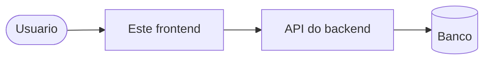
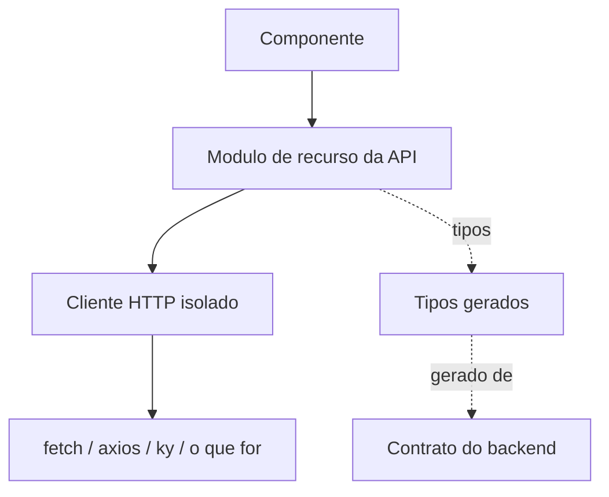
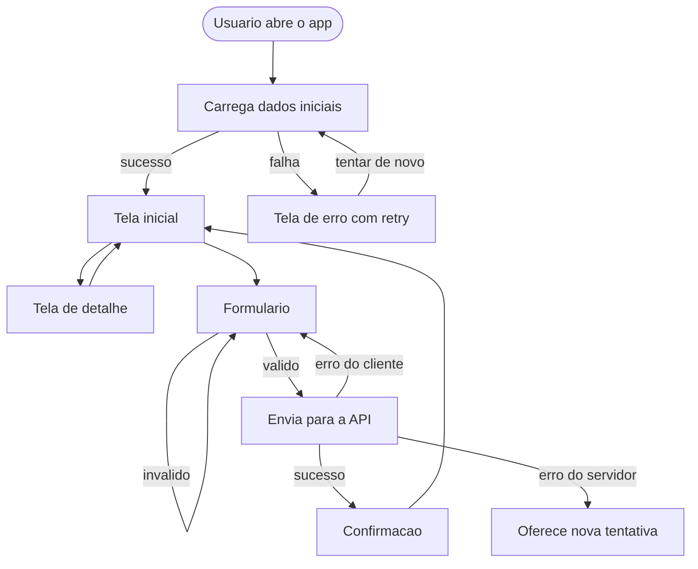

# Arquitetura

> **Esqueleto do template.** As regras estruturais abaixo valem para
> qualquer stack; o que depende da escolha do projeto esta marcado como
> `A DECIDIR` ou com `<!-- -->`.
>
> Um agente de IA deve tratar um `A DECIDIR` remanescente como sinal de que
> a decisao ainda nao foi tomada — e perguntar, nao escolher sozinho.
> O [`BOOTSTRAP.md`](BOOTSTRAP.md) conduz essas perguntas.

**Ultima revisao:** <!-- AAAA-MM-DD --> · **Responsavel:** <!-- time/pessoa -->

---

## 1. Visao geral

<!--
Em ate 10 linhas: o que este frontend e, com quem conversa, o que NAO faz.
Se o sistema tem mais de um frontend ou backend, diga o papel deste repo.
-->



<!-- Ajuste o diagrama a realidade: CDN, BFF, auth, quantos backends. -->

**Tipo de aplicacao:** `A DECIDIR` — ver [`STACK.md`](STACK.md) secao 1.

### Consequencias do tipo escolhido

Preencha depois de decidir; estas quatro respostas determinam muita coisa
adiante:

| Pergunta | Resposta |
| --- | --- |
| Onde o codigo executa? | <!-- cliente / servidor / ambos --> |
| Variavel de ambiente resolvida em build ou runtime? | <!-- --> |
| Um artefato pode ser promovido entre ambientes? | <!-- --> |
| Existe onde guardar segredo? | <!-- em SPA: nao --> |

> Se as variaveis sao resolvidas em **build**, cada ambiente refaz o build e
> nao existe "build once, deploy many". Isso e uma restricao operacional
> real: registre-a aqui em vez de descobri-la em uma promocao de release.

---

## 2. Estrutura de pastas

### O que a fundacao ja define

```
.
├── .github/          workflows, templates de issue/PR, CODEOWNERS
├── .githooks/        hooks de git versionados
├── docker/           exemplos de Dockerfile e compose
├── scripts/          convencoes, deploy e utilitarios
├── Makefile          contrato de comandos
└── project.mk        comandos reais da stack
```

### O que o projeto define

<!--
Documente a estrutura escolhida. Sugestao de ponto de partida; ajuste ao
que a ferramenta de scaffolding gerou.
-->

```
src/
├── ...
```

### Regras estruturais (valem para qualquer stack)

- **Co-localizacao.** Teste e estilo ficam ao lado do que testam e estilizam.
  Achar o teste de um componente nao pode exigir busca.
- **Dependencia aponta para dentro.** UI pode usar infraestrutura;
  infraestrutura nao conhece UI. Se `lib/` precisou saber o que e um
  "pedido", nao e `lib/`.
- **Uma pasta por conceito, nao por tipo de arquivo.** `features/pedidos/`
  envelhece melhor que `components/ + hooks/ + utils/` espalhados, assim que
  o app passa de umas poucas telas.
- **Sem barrel file gigante.** Um `index` que reexporta a pasta inteira
  quebra tree-shaking e cria import circular.
- **Codigo gerado em pasta propria**, marcada como tal, fora do lint e da
  cobertura, e nunca editada a mao. So o que e **regenerado automaticamente**
  (tipos e cliente da API). Codigo exportado de ferramenta de design NAO e
  codigo gerado: ver secao 5, "Design e tokens".

---

## 3. Gerenciamento de estado

**Status: A DECIDIR.**

### Criterio de decisao

Antes de adicionar qualquer biblioteca, classifique o estado. A maior parte
das arquiteturas de estado infladas nasce de pular esta etapa:

| Tipo | Exemplo | Onde deve morar |
| --- | --- | --- |
| Local de componente | input aberto, aba ativa | Estado local do proprio componente |
| Compartilhado entre irmaos | filtro que dois paineis leem | Estado no ancestral mais proximo |
| Global de UI | tema, idioma, notificacao | Mecanismo de contexto do framework |
| **Servidor** | lista vinda da API, cache, revalidacao | Biblioteca de data fetching |
| URL | filtro, paginacao, aba compartilhavel | Query string — a URL e estado |
| Sessao | token, usuario logado | Modulo dedicado + camada de rede |

O que costuma virar "estado global" e, quase sempre, **estado de servidor**:
cache de resposta de API. Isso quer dizer cache, invalidacao, revalidacao,
deduplicacao e estado de carregamento — problema resolvido por biblioteca
dedicada, nao por um store.

### Decisao do projeto

<!--
  - Ferramenta e versao
  - Quais tipos da tabela acima ela cobre
  - O que ficou de fora e por que
  - Onde os providers sao montados
-->

`A DECIDIR`

---

## 4. Roteamento

**Status: A DECIDIR.**

### O que a escolha do tipo de aplicacao ja implica

| Roteamento | Exigencia de infraestrutura |
| --- | --- |
| No cliente | O servidor/CDN precisa devolver o documento raiz para qualquer rota desconhecida. Sem isso, abrir uma URL profunda direto devolve 404. |
| No servidor | O framework resolve; atencao a cache e a rota dinamica. |

Se o roteamento for no cliente, configure o fallback **antes** do primeiro
deploy — e o bug que sempre aparece tarde, quando alguem compartilha um link.
Ver `docker/nginx.conf.example` e [`DEPLOY.md`](DEPLOY.md).

### Decisao do projeto

<!--
  - Biblioteca e versao
  - Estrutura: rotas em arquivo unico ou baseada em arquivos
  - Code splitting: quais rotas sao lazy
  - Rotas protegidas: onde mora a guarda de autenticacao
  - Comportamento de 404 e de erro de rota
-->

`A DECIDIR`

### Mapa de rotas

| Rota | Tela | Protegida | Observacao |
| --- | --- | --- | --- |
| <!-- --> | <!-- --> | <!-- --> | <!-- --> |

---

## 5. Organizacao de componentes

### Camadas

| Camada | Responsabilidade | Pode | Nao pode |
| --- | --- | --- | --- |
| **UI** | Aparencia e interacao | Receber dados, emitir eventos | Chamar API, conhecer rota |
| **Composicao** | Juntar UI + dados | Chamar a camada de API, orquestrar estado | Ter logica de apresentacao complexa propria |
| **Infraestrutura** | Transporte, formatacao, utilidades | Ser usada por qualquer camada | Conhecer o dominio |

A separacao existe por um motivo pratico: componente de UI sem dependencia
de rede se testa em milissegundos, sem mock.

### Convencoes

- Um componente com mais de ~150 linhas ou mais de tres responsabilidades
  provavelmente sao dois componentes.
- Composicao acima de configuracao: prefira aninhar conteudo a adicionar um
  oitavo booleano.
- Contrato de entrada (props/inputs) tipado e exportado.
- Estilo com escopo garantido, valores sempre vindos de tokens.
- Mobile-first: o estilo base e o do celular; media query so acrescenta.

### Design e tokens

**Fonte do design:** `A DECIDIR` <!-- ferramenta e link: Claude Design, Figma,
design system da organizacao -->

A ferramenta de design nao muda a estrutura deste repositorio: o design e
**insumo**, e o codigo continua passando pelo mesmo contrato (`project.mk`),
CI e revisao. Quatro regras fazem a ponte:

1. **Tokens sao a interface entre design e codigo.** Cor, tipografia,
   espacamento, raio e sombra do design viram **um** arquivo de tokens no
   codigo (<!-- ex.: src/styles/tokens.css com variaveis CSS, ou tokens.json -->).
   Componente usa token, nunca valor literal. Mudou o visual global? Muda o
   token, nao cem componentes. De preferencia, faca disso regra de lint
   (ex.: proibir cor hexadecimal fora do arquivo de tokens).
2. **Codigo exportado pela ferramenta e ponto de partida, nao atalho.** HTML
   ou componentes exportados entram por PR como qualquer codigo: lint
   (inclusive acessibilidade), testes, orcamento de bundle. Adapte-os aos
   componentes e tokens que ja existem em vez de duplicar. **Nunca** os
   coloque na pasta de codigo gerado para escapar do lint.
3. **O design nao garante acessibilidade.** Contraste de 4.5:1, foco visivel,
   navegacao por teclado e rotulos continuam cobrados pelo lint, pelo
   `make perf` e pelo checklist do PR. Corrigir o design por acessibilidade
   e correcao, nao divergencia: registre no PR e avise quem desenha.
4. **O agente precisa ver o design.** A issue traz o link da tela; se o time
   exportar telas ou especificacoes, elas ficam em <!-- ex.: docs/design/ -->.
   Sem design de referencia, o agente pergunta, nao inventa layout.

### Catalogo

<!-- Preencha conforme o design system tomar forma. Com Storybook, aponte
     para ele em vez de manter a lista a mao. -->

| Componente | Papel | Observacao |
| --- | --- | --- |
| <!-- --> | <!-- --> | <!-- --> |

---

## 6. Camada de dados

Desenho que vale para qualquer stack:



Quatro regras que sustentam o desenho:

1. Componente nunca fala com o transporte — fala com o modulo do recurso.
2. Modulo de recurso nunca declara tipo de resposta a mao — importa do
   contrato gerado.
3. Os tipos nunca sao escritos a mao — vem de `make generate-types`.
4. O transporte existe em **um** lugar.

> **Transforme a regra 4 em regra de lint.** Uma regra como
> `no-restricted-globals` para `fetch`, com excecao para a pasta do cliente
> HTTP, custa cinco minutos e sobrevive a rotatividade de time. Um acordo
> verbal nao sobrevive ao terceiro mes.

Com isso, trocar de cliente HTTP, adicionar retry, tracing ou header de
autenticacao e mexer em um arquivo — nao em cento e vinte chamadas.

### Erros

Defina **um** tipo de erro da camada de rede, que distinga ao menos: status
HTTP de erro, falha de rede, timeout, cancelamento e falha de
desserializacao. A UI trata esse tipo, nunca o erro cru do transporte.

<!--
Preencha por projeto:
  - Politica de retry: onde mora, quantas tentativas, backoff
  - O que fazer em 401: redirecionar? renovar token? onde?
  - Como o erro chega ao usuario: toast, boundary, inline
-->

---

## 7. Fluxo de telas

<!--
PLACEHOLDER. Substitua pelo fluxo real. Mantenha pequeno: passando de ~15
nos, quebre em um diagrama por fluxo.
-->



### Estados obrigatorios por tela

Toda tela que busca dados precisa cobrir os quatro. Tela que so implementa o
caminho feliz nao esta pronta — e essa e a origem mais comum de bug
reportado por usuario.

| Estado | Regra |
| --- | --- |
| Carregando | Sem salto de layout: reserve o espaco (protege o CLS) |
| Vazio | Explica o que aconteceu e qual a proxima acao |
| Erro | Mensagem util + acao de retry; nunca expor stack ou corpo cru |
| Sucesso | O conteudo |

---

## 8. Performance

Dois controles, ambos plugados no contrato e **bloqueantes** no CI:

| Controle | Alvo do Makefile | Limite |
| --- | --- | --- |
| Orcamento de bundle | `make bundle-budget` | <!-- --> |
| Core Web Vitals | `make perf` | <!-- LCP / CLS / INP --> |

Comece com limites medidos a partir do build real e aperte depois. Limite
irreal e desligado na primeira semana — e ai voce nao tem orcamento nenhum.

Aumentar qualquer limite exige aprovacao humana (`AGENTS.md` secao 6) e
justificativa no PR.

<!-- Registre decisoes de performance: lazy loading, prefetch, imagens,
     fontes, o que foi medido e quando. -->

---

## 9. Acessibilidade

Nao e secao separada do trabalho — e criterio de pronto (`AGENTS.md` secao
5). O que a fundacao ja cobra:

| Camada | Onde |
| --- | --- |
| Regras de lint de a11y | `make lint` (requisito de `STACK.md` secao 4) |
| Score de acessibilidade | `make perf` |
| Checklist no review | `.github/pull_request_template.md` |

<!-- Registre o nivel alvo (ex.: WCAG 2.2 AA), decisoes de contraste,
     ferramentas de teste manual e exclusoes acordadas. -->

---

## 10. Decisoes arquiteturais

<!--
Registro curto, uma linha por decisao. Se precisar de mais de um paragrafo,
escreva um ADR em docs/adr/ (modelo em docs/adr/0001) e aponte para ele aqui.
Decisao que afeta mais de um repositorio vai para o docs/adr/ do docs/shared.
-->

| Data | Decisao | Motivo | Alternativa descartada |
| --- | --- | --- | --- |
| <!-- --> | <!-- --> | <!-- --> | <!-- --> |
