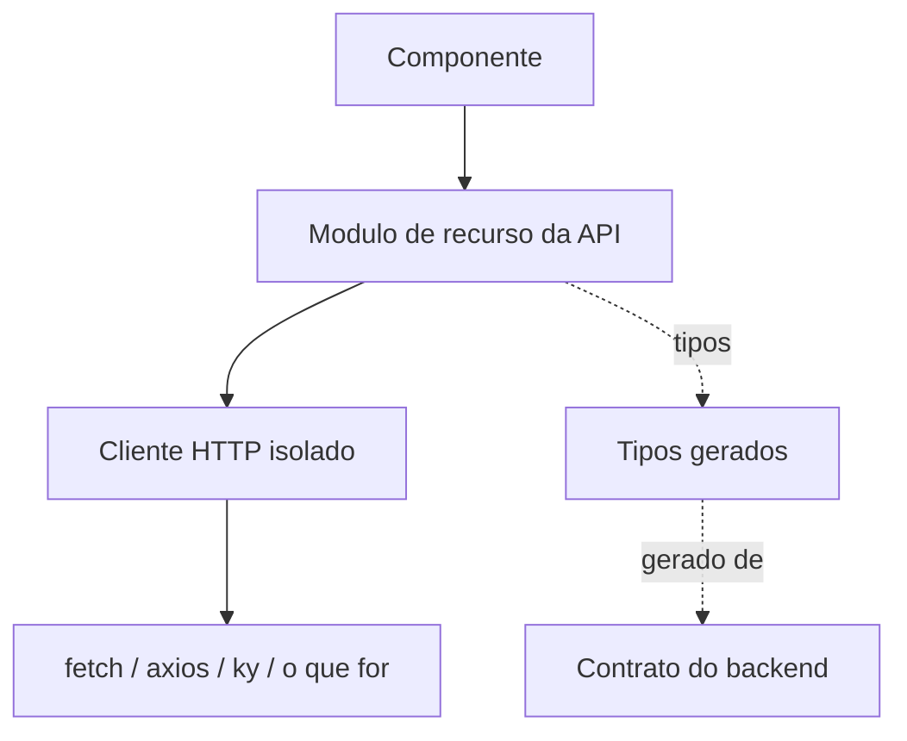

# Arquitetura

> **Esqueleto do template.** As regras estruturais abaixo valem para
> qualquer stack; o que depende da escolha do projeto esta marcado como
> `A DECIDIR` ou com `<!-- -->`.
>
> Um agente de IA deve tratar um `A DECIDIR` remanescente como sinal de que
> a decisao ainda nao foi tomada — e perguntar, nao escolher sozinho.
> O [`BOOTSTRAP.md`](BOOTSTRAP.md) conduz essas perguntas.

**Ultima revisao:** 2026-10-18 · **Responsavel:** Igor (@IgorOCosta)

---

## 1. Visao geral

<!--
Em ate 10 linhas: o que este frontend e, com quem conversa, o que NAO faz.
Se o sistema tem mais de um frontend ou backend, diga o papel deste repo.
-->


<!-- Ajuste o diagrama a realidade: CDN, BFF, auth, quantos backends. -->

**Tipo de aplicacao:** Hibrido (SSG para landing, termos e privacidade; SPA
para app, `/admin` e paginas por token) — ver [`STACK.md`](STACK.md) secao 1.

### Consequencias do tipo escolhido

Preencha depois de decidir; estas quatro respostas determinam muita coisa
adiante:

| Pergunta | Resposta |
| --- | --- |
| Onde o codigo executa? | Cliente. Paginas estaticas geradas em build; sem servidor proprio |
| Variavel de ambiente resolvida em build ou runtime? | Build (a revisar na etapa 6) |
| Um artefato pode ser promovido entre ambientes? | Nao, enquanto a URL da API for resolvida em build |
| Existe onde guardar segredo? | Nao. Nada sensivel no frontend; access token so em memoria |

> Se as variaveis sao resolvidas em **build**, cada ambiente refaz o build e
> nao existe "build once, deploy many". Isso e uma restricao operacional
> real: registre-a aqui em vez de descobri-la em uma promocao de release.

---

## 2. Estrutura de pastas

### O que a fundacao ja define

```
.
├── .github/          workflows, templates de issue/PR, CODEOWNERS
├── .githooks/        hooks de git versionados
├── docker/           exemplos de Dockerfile e compose
├── scripts/          convencoes, deploy e utilitarios
├── Makefile          contrato de comandos
└── project.mk        comandos reais da stack
```

### O que o projeto define

Nuxt 4: o codigo do app fica em `app/` (srcDir).

```
app/
├── api/              cliente HTTP, ApiError, tipos gerados (generated.ts)
├── pages/            rotas por arquivo (mapa na secao 4)
├── app.vue           raiz: skip link, cabecalho de idioma
└── (a criar)         components/, composables/, stores/, middleware/
i18n/locales/         en.json, pt-BR.json (unico lugar com texto visivel)
e2e/                  testes Playwright
design/               prototipo e design-system (fonte; nao e codigo do produto)
public/               arquivos estaticos
```

### Regras estruturais (valem para qualquer stack)

- **Co-localizacao.** Teste e estilo ficam ao lado do que testam e estilizam.
  Achar o teste de um componente nao pode exigir busca.
- **Dependencia aponta para dentro.** UI pode usar infraestrutura;
  infraestrutura nao conhece UI. Se `lib/` precisou saber o que e um
  "pedido", nao e `lib/`.
- **Uma pasta por conceito, nao por tipo de arquivo.** `features/pedidos/`
  envelhece melhor que `components/ + hooks/ + utils/` espalhados, assim que
  o app passa de umas poucas telas.
- **Sem barrel file gigante.** Um `index` que reexporta a pasta inteira
  quebra tree-shaking e cria import circular.
- **Codigo gerado em pasta propria**, marcada como tal, fora do lint e da
  cobertura, e nunca editada a mao. So o que e **regenerado automaticamente**
  (tipos e cliente da API). Codigo exportado de ferramenta de design NAO e
  codigo gerado: ver secao 5, "Design e tokens".

---

## 3. Gerenciamento de estado

**Status: decidido (bootstrap, etapa 9).**

### Criterio de decisao

Antes de adicionar qualquer biblioteca, classifique o estado. A maior parte
das arquiteturas de estado infladas nasce de pular esta etapa:

| Tipo | Exemplo | Onde deve morar |
| --- | --- | --- |
| Local de componente | input aberto, aba ativa | Estado local do proprio componente |
| Compartilhado entre irmaos | filtro que dois paineis leem | Estado no ancestral mais proximo |
| Global de UI | tema, idioma, notificacao | Mecanismo de contexto do framework |
| **Servidor** | lista vinda da API, cache, revalidacao | Biblioteca de data fetching |
| URL | filtro, paginacao, aba compartilhavel | Query string — a URL e estado |
| Sessao | token, usuario logado | Modulo dedicado + camada de rede |

O que costuma virar "estado global" e, quase sempre, **estado de servidor**:
cache de resposta de API. Isso quer dizer cache, invalidacao, revalidacao,
deduplicacao e estado de carregamento — problema resolvido por biblioteca
dedicada, nao por um store.

### Decisao do projeto

| Tipo de estado | Ferramenta |
| --- | --- |
| Servidor (listas, cache, revalidacao, polling por componente na Home) | TanStack Query (`@tanstack/vue-query`) |
| Global de UI e sessao | Pinia, **so** para: sessao (access token apenas em memoria), loja atual (valor do `x-store-id`), idioma e tema |
| Formularios | VeeValidate com Zod; mensagens por chave de i18n; o servidor sempre vale e seus erros por `code` aparecem nos campos |
| Local, irmaos, URL | Estado local do componente, ancestral proximo e query string (filtros, abas, paginacao por cursor) |

Tudo o mais que vem da API fica no cache de servidor, nunca copiado para o
Pinia. Versoes sao fixadas no scaffold, com aprovacao das dependencias.

**Observabilidade:** sem telemetria nem analytics de terceiros (LGPD). Coleta
de erro em producao fica para depois da VPS (A7), com GlitchTip na propria
VPS; qualquer relatorio remove dado pessoal e **o fragmento da URL**, onde
vai o token das paginas publicas.

---

## 4. Roteamento

**Status: decidido (bootstrap, etapa 9).**

### O que a escolha do tipo de aplicacao ja implica

| Roteamento | Exigencia de infraestrutura |
| --- | --- |
| No cliente | O servidor/CDN precisa devolver o documento raiz para qualquer rota desconhecida. Sem isso, abrir uma URL profunda direto devolve 404. |
| No servidor | O framework resolve; atencao a cache e a rota dinamica. |

Se o roteamento for no cliente, configure o fallback **antes** do primeiro
deploy — e o bug que sempre aparece tarde, quando alguem compartilha um link.
Ver `docker/nginx.conf.example` e [`DEPLOY.md`](DEPLOY.md).

### Decisao do projeto

- **Biblioteca:** roteador do Nuxt (vue-router), rotas baseadas em arquivos.
- **URLs em ingles**, sem slugs traduzidos; o idioma nunca muda o caminho do
  app. Landing, termos e privacidade: ingles em `/`, portugues em `/pt-BR/`,
  com `hreflang` e `x-default` em `/` (pre-renderizadas).
- **Code splitting:** por rota (padrao do Nuxt).
- **Protecao:** middleware de rota para sessao, loja escolhida, permissao do
  papel (OWNER/STAFF) e `is_platform_admin` em `/admin`. A verdade e o servidor
  (403 `MISSING_PERMISSION` ou `OWNER_REQUIRED` mostra o estado de sem permissao).
- **404 e erro:** pagina 404 do design; o erro de rota usa a mesma tela.
- **Rotas privadas e por token:** `noindex` e `Referrer-Policy: no-referrer`
  no proxy reverso. O app nao poe a loja na URL: ela vem do Pinia, entao o link
  de uma tela nao muda de loja por conta propria.
- **Idioma:** so landing, termos e privacidade tem idioma na URL (ingles em `/`,
  portugues em `/pt-BR/`). Paginas do app usam `definePageMeta({ i18n: false })` e
  recebem o idioma da pessoa: o salvo no perfil (logada), depois o escolhido a mao
  neste aparelho (`localStorage`, chave `language`), depois o do navegador
  (`pt` vira `pt-BR`, o resto `en`). Quem entra pelo `/` de um navegador em
  portugues ve ingles: a landing nao redireciona, por causa do SEO.
- **Guards por metadado:** cada pagina protegida declara
  `definePageMeta({ access: { level, owner?, permission? } })` (`level`:
  `session`, `store` ou `admin`). A pagina sem `access` e publica. O
  middleware global `app/middleware/access.global.ts` restaura a sessao, carrega
  `GET /v1/me` ou `GET /v1/store` e entrega a decisao a `decideAccess`
  (`app/utils/access.ts`, funcao pura e testada): sem sessao vai para
  `/login?redirect=...` (so caminhos internos, `safeRedirectPath`); sem loja vai
  para `/stores`; sem permissao mostra o estado 403 em `app/error.vue` dizendo
  qual permissao falta. O proprietario passa em tudo na loja.
- **403 do servidor:** `MISSING_PERMISSION` e `OWNER_REQUIRED` mostram o estado
  de sem permissao; um 403 sem esses codigos (loja que a pessoa nao integra
  mais) limpa a loja atual e volta a `/stores` (`forbiddenAction`).
- **Loja atual:** guardada na store `access` e lembrada em `localStorage`
  (id da loja, nao e segredo); o cabecalho `x-store-id` sai dela.
- **Rotas protegidas sao so de cliente:** toda rota com `access` precisa de
  `routeRules` `ssr: false` (e a versao `/pt-BR/...` enquanto o prefixo existir).
- **Redirecionamento temporario:** `/convite` vai para `/invite` preservando o
  fragmento, ate o Backend mudar o link do e-mail (Backend#89).

### Mapa de rotas

| Rota | Tela (design) | Protegida | Observacao |
| --- | --- | --- | --- |
| `/`, `/pt-BR/` | Landing (`landing.html`) | Nao | SSG, indexavel |
| `/terms`, `/privacy` (e `/pt-BR/...`) | Termos, privacidade | Nao | SSG, indexavel |
| `/request-access` | Solicitar acesso | Nao | Campo-isca `website` vazio |
| `/login` | Login por OTP | Nao | |
| `/invite` | Aceitar convite | Nao | Token no fragmento; noindex |
| `/settlement` | Acerto do comprador | Nao | Token no fragmento; noindex |
| `/consignor` | Acompanhamento do consignador | Nao | Token no fragmento + 4 digitos do CPF; noindex |
| `/showcase` | Vitrine publica | Nao | Pagina de cliente, dado ao vivo |
| `/stores`, `/stores/new` | Selecao e nova loja | Sessao | Nova loja so com a permissao global |
| `/home` | Home ao vivo (e estados vazio, sem permissao, WhatsApp caiu) | Loja | |
| `/inventory`, `/inventory/new`, `/inventory/:id` | Estoque, cadastro, detalhe | Loja | `can_manage_inventory`; excluir pede `can_delete` |
| `/auctions`, `/auctions/:id`, `/auctions/:id/edit`, `/auctions/:id/poll` | Leiloes, sala, edicao, aprovar enquete | Loja | `can_manage_auctions` |
| `/customers`, `/customers/:id`, `/blacklist` | Clientes, perfil 360, blacklist | Loja | `can_manage_customers` |
| `/shipments` | Acertos e envios | Loja | |
| `/finance` | Financeiro | Loja | `can_view_finance`; unico com periodo |
| `/team` | Equipe | Proprietario | |
| `/settings`, `/plan` | Configuracoes, plano | Loja | Plano: troca so por solicitacao |
| `/activity` | Notificacoes e log | Loja | Log so do proprietario |
| `/profile` | Perfil | Sessao | |
| `/admin`, `/admin/users`, `/admin/users/:id`, `/admin/stores`, `/admin/stores/new`, `/admin/invitations` | Area de administracao | Administrador | Sem dado interno das lojas |
| `*` | 404 | Nao | |

---

## 5. Organizacao de componentes

### Camadas

| Camada | Responsabilidade | Pode | Nao pode |
| --- | --- | --- | --- |
| **UI** | Aparencia e interacao | Receber dados, emitir eventos | Chamar API, conhecer rota |
| **Composicao** | Juntar UI + dados | Chamar a camada de API, orquestrar estado | Ter logica de apresentacao complexa propria |
| **Infraestrutura** | Transporte, formatacao, utilidades | Ser usada por qualquer camada | Conhecer o dominio |

A separacao existe por um motivo pratico: componente de UI sem dependencia
de rede se testa em milissegundos, sem mock.

### Convencoes

- Um componente com mais de ~150 linhas ou mais de tres responsabilidades
  provavelmente sao dois componentes.
- Composicao acima de configuracao: prefira aninhar conteudo a adicionar um
  oitavo booleano.
- Contrato de entrada (props/inputs) tipado e exportado.
- Estilo com escopo garantido, valores sempre vindos de tokens.
- Mobile-first: o estilo base e o do celular; media query so acrescenta.

### Design e tokens

**Fonte do design:** Claude Design; prototipo em `design/` (41 telas) e
`design/design-system/` (`tokens.css`, `components.css`, `app.js`, `icons.svg`).
**Decisao (etapa 9):** portar `tokens.css` e `components.css` como CSS global
(classes BEM do design), com componentes Vue finos por cima e **sem Tailwind**.
Os tokens so mudam por atualizacao vinda do design. Fontes (Sora, DM Sans,
JetBrains Mono) autohospedadas via Fontsource, nunca do Google. `app.js` do
design e so vitrine de componentes e nao vai para o produto. Tema claro,
escuro e sistema por `data-theme`.

A ferramenta de design nao muda a estrutura deste repositorio: o design e
**insumo**, e o codigo continua passando pelo mesmo contrato (`project.mk`),
CI e revisao. Quatro regras fazem a ponte:

1. **Tokens sao a interface entre design e codigo.** Cor, tipografia,
   espacamento, raio e sombra do design viram **um** arquivo de tokens no
   codigo (`app/assets/css/tokens.css`, portado de `design/design-system/tokens.css`).
   Componente usa token, nunca valor literal. Mudou o visual global? Muda o
   token, nao cem componentes. De preferencia, faca disso regra de lint
   (ex.: proibir cor hexadecimal fora do arquivo de tokens).
2. **Codigo exportado pela ferramenta e ponto de partida, nao atalho.** HTML
   ou componentes exportados entram por PR como qualquer codigo: lint
   (inclusive acessibilidade), testes, orcamento de bundle. Adapte-os aos
   componentes e tokens que ja existem em vez de duplicar. **Nunca** os
   coloque na pasta de codigo gerado para escapar do lint.
3. **O design nao garante acessibilidade.** Contraste de 4.5:1, foco visivel,
   navegacao por teclado e rotulos continuam cobrados pelo lint, pelo
   `make perf` e pelo checklist do PR. Corrigir o design por acessibilidade
   e correcao, nao divergencia: registre no PR e avise quem desenha.
4. **O agente precisa ver o design.** A issue traz o link da tela; se o time
   exportar telas ou especificacoes, elas ficam em <!-- ex.: docs/design/ -->.
   Sem design de referencia, o agente pergunta, nao inventa layout.

### Catalogo

<!-- Preencha conforme o design system tomar forma. Com Storybook, aponte
     para ele em vez de manter a lista a mao. -->

| Componente | Papel | Observacao |
| --- | --- | --- |
| <!-- --> | <!-- --> | <!-- --> |

---

## 6. Camada de dados

Desenho que vale para qualquer stack:



Quatro regras que sustentam o desenho:

1. Componente nunca fala com o transporte — fala com o modulo do recurso.
2. Modulo de recurso nunca declara tipo de resposta a mao — importa do
   contrato gerado.
3. Os tipos nunca sao escritos a mao — vem de `make generate-types`.
4. O transporte existe em **um** lugar.

> **Transforme a regra 4 em regra de lint.** Uma regra como
> `no-restricted-globals` para `fetch`, com excecao para a pasta do cliente
> HTTP, custa cinco minutos e sobrevive a rotatividade de time. Um acordo
> verbal nao sobrevive ao terceiro mes.

Com isso, trocar de cliente HTTP, adicionar retry, tracing ou header de
autenticacao e mexer em um arquivo — nao em cento e vinte chamadas.

### Erros

Defina **um** tipo de erro da camada de rede, que distinga ao menos: status
HTTP de erro, falha de rede, timeout, cancelamento e falha de
desserializacao. A UI trata esse tipo, nunca o erro cru do transporte.

### Decisoes deste projeto (bootstrap, etapa 7)

- **Contrato:** `openapi.yaml` gerado pelo Backend, publicado em
  `Project-PKA/shared` (`CONTRACT_REPO`). Tipos gerados com `openapi-typescript`
  em `app/api/generated.ts` (`make generate-types`); o arquivo gerado nunca e
  editado a mao. O `sync-api-types.yml` abre PR quando o contrato muda.
- **Cliente:** fino e proprio sobre `fetch` (sem biblioteca de cliente), em
  `app/api/`. Regra de lint (`no-restricted-globals` para `fetch` e
  `$fetch`) proibe chamada fora dessa pasta.
- **Erro:** `ApiError` proprio, distinguindo erro HTTP (corpo RFC 9457 com
  `code` estavel), falha de rede, timeout, cancelamento e falha de
  desserializacao. A UI traduz pelo `code`, nunca mostra o `detail`.
- **401:** uma tentativa de `POST /v1/auth/refresh` (cookie `refresh_token`,
  `credentials: 'include'`) e repete a chamada; se falhar, vai para o login.
  O access token vive so em memoria.
- **403** com `MISSING_PERMISSION` ou `OWNER_REQUIRED`: estado de sem permissao.
- **Rotas de loja:** `Authorization: Bearer` e `x-store-id` injetados pelo
  cliente.
- **Paginas publicas:** o token e lido do fragmento da URL e enviado no
  corpo do POST; resposta `PUBLIC_LINK_NOT_FOUND` mostra uma mensagem generica
  unica.
- **Dinheiro:** string decimal da API, nunca convertida para `number`.
- **Retry de rede:** a definir na implementacao do cliente; nao ha retry
  automatico em escrita (POST/PATCH/DELETE).

---

## 7. Fluxo de telas

<!--
PLACEHOLDER. Substitua pelo fluxo real. Mantenha pequeno: passando de ~15
nos, quebre em um diagrama por fluxo.
-->


### Estados obrigatorios por tela

Toda tela que busca dados precisa cobrir os quatro. Tela que so implementa o
caminho feliz nao esta pronta — e essa e a origem mais comum de bug
reportado por usuario.

| Estado | Regra |
| --- | --- |
| Carregando | Sem salto de layout: reserve o espaco (protege o CLS) |
| Vazio | Explica o que aconteceu e qual a proxima acao |
| Erro | Mensagem util + acao de retry; nunca expor stack ou corpo cru |
| Sucesso | O conteudo |

---

## 8. Performance

Dois controles, ambos plugados no contrato e **bloqueantes** no CI:

| Controle | Alvo do Makefile | Limite |
| --- | --- | --- |
| Orcamento de bundle | `make bundle-budget` (`size-limit`) | A medir no primeiro build; folgado, apertado depois |
| Core Web Vitals | `make perf` (Lighthouse CI, perfil mobile) | A medir no primeiro build. Alvo inicial: LCP, CLS e INP no "bom" do Web Vitals; acessibilidade >= 0.95 |

**Decisao (etapa 8):** publico principal e lojista em celular, entao o perfil e
mobile. Lighthouse CI cobre a landing (estatica) e o shell do app (login). Os
limites so sao fixados depois do primeiro build real e entram em `project.mk`
e na configuracao das ferramentas; ate la os alvos ficam pendentes. Fontes
autohospedadas e imagens com dimensao explicita ajudam LCP e CLS.

Comece com limites medidos a partir do build real e aperte depois. Limite
irreal e desligado na primeira semana — e ai voce nao tem orcamento nenhum.

Aumentar qualquer limite exige aprovacao humana (`AGENTS.md` secao 6) e
justificativa no PR.

<!-- Registre decisoes de performance: lazy loading, prefetch, imagens,
     fontes, o que foi medido e quando. -->

---

## 9. Acessibilidade

Nao e secao separada do trabalho — e criterio de pronto (`AGENTS.md` secao
5). O que a fundacao ja cobra:

| Camada | Onde |
| --- | --- |
| Regras de lint de a11y | `make lint` (requisito de `STACK.md` secao 4) |
| Score de acessibilidade | `make perf` |
| Checklist no review | `.github/pull_request_template.md` |

<!-- Registre o nivel alvo (ex.: WCAG 2.2 AA), decisoes de contraste,
     ferramentas de teste manual e exclusoes acordadas. -->

---

## 10. Decisoes arquiteturais

<!--
Registro curto, uma linha por decisao. Se precisar de mais de um paragrafo,
escreva um ADR em docs/adr/ (modelo em docs/adr/0001) e aponte para ele aqui.
Decisao que afeta mais de um repositorio vai para o docs/adr/ do docs/shared.
-->

| Data | Decisao | Motivo | Alternativa descartada |
| --- | --- | --- | --- |
| <!-- --> | <!-- --> | <!-- --> | <!-- --> |
