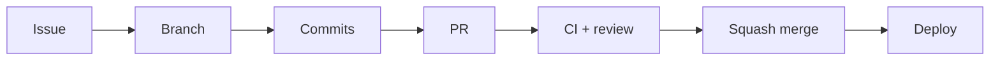

# Como contribuir

Este documento descreve o fluxo de trabalho. O contexto do projeto (o que
ele e, como se roda, o que exige aprovacao humana) esta em
[`AGENTS.md`](AGENTS.md) — ele vale para pessoas e para agentes de IA.

---

## Antes do primeiro commit

```bash
make setup      # instala dependencias e ativa os hooks de git
make doctor     # confirma que o contrato esta completo
```

`make setup` aponta `core.hooksPath` para `.githooks/`. Git nao ativa hooks
versionados sozinho — e preciso fazer isso uma vez por clone.

**Windows:** `make` nao vem instalado. Use WSL ou
`winget install ezwinports.make`. Os hooks e os validadores rodam em `sh` e
funcionam no Git Bash sem instalar nada.

---

## Fluxo



### 1. Comece por uma issue

Toda mudanca que nao seja trivial nasce de uma issue. Ela e o lugar de
discutir **o que** e **por que**; o PR discute o **como**.

Templates: [bug](.github/ISSUE_TEMPLATE/bug_report.md) ·
[feature](.github/ISSUE_TEMPLATE/feature_request.md)

### 2. Crie a branch

```
<prefixo>/<slug-em-minusculas>
```

| Prefixo | Quando |
| --- | --- |
| `feature/` | Funcionalidade nova |
| `fix/` | Correcao de bug |
| `hotfix/` | Correcao urgente em producao |
| `release/` | Preparacao manual de release (raro: o release-please cobre o normal) |
| `chore/` | Manutencao, dependencias, infra |
| `docs/` | So documentacao |
| `refactor/` | Muda o codigo sem mudar comportamento |
| `test/` | So testes |

O slug aceita `a-z`, `0-9`, `.`, `-` e `_`. Branches abertas por automacao
(`dependabot/*`, `renovate/*`, `release-please--*`) sao isentas.

```bash
git switch -c feature/filtro-por-data
```

Validado no hook `pre-push` e no job `conventions` do CI — **a mesma regra**,
definida uma vez em `scripts/conventions.sh`.

```bash
make check-branch    # valida a branch atual
```

### 3. Faca commits em Conventional Commits

```
<tipo>(<escopo opcional>): <descricao no imperativo>

<corpo opcional>

<rodape opcional>
```

**Tipos:** `feat`, `fix`, `docs`, `style`, `refactor`, `perf`, `test`,
`build`, `ci`, `chore`, `revert`.

```
feat(checkout): valida cupom antes de habilitar o botao
fix(http): trata timeout como erro recuperavel
docs(testing): explica o criterio de componente vs e2e
feat(api)!: remove o campo legado de resposta
```

Regras verificadas automaticamente:

- descricao no **imperativo** ("adiciona", nao "adicionado");
- minuscula, sem ponto final;
- cabecalho de ate 100 caracteres;
- breaking change: `!` depois do tipo **e** rodape
  `BREAKING CHANGE: <o que quebrou e como migrar>`.

```bash
make check-commits   # valida os commits contra origin/main
```

**O que roda em cada hook:**

| Hook | O que faz |
| --- | --- |
| `pre-commit` | `make format-check` e `make lint` (pula os alvos ainda nao configurados) |
| `commit-msg` | Valida a mensagem |
| `pre-push` | Valida o nome da branch e roda `make typecheck` |

Nunca use `--no-verify` para contornar um hook: o CI aplica as mesmas
regras, entao pular aqui so adia a falha. Se um hook atrapalha de forma
legitima, conserte a regra em um PR proprio.

### 4. Antes de abrir o PR

```bash
make validate    # formato + lint + tipos + testes
make build       # confirma que o build de producao passa
make e2e         # quando a mudanca afeta fluxo de tela
```

Checklist completo de "a tarefa esta pronta":
[`AGENTS.md` secao 5](AGENTS.md#5-checklist-de-conclusao-de-tarefa).

### 5. Abra o PR

- **Titulo em Conventional Commits** — ele vira a mensagem do squash merge,
  entao e ele que fica no historico de `main`.
- Preencha o [template](.github/pull_request_template.md) inteiro. Nao apague
  secoes; marque "nao se aplica" e justifique.
- Vincule a issue com `Closes #N`.
- Evidencia visual quando mexer na UI, incluindo mobile.
- PR pequeno. Refatoracao ampla vai separada da mudanca de comportamento —
  misturar as duas torna o review inutil.

### 6. Review

O que acontece automaticamente:

| Automacao | O que faz | Bloqueia? |
| --- | --- | --- |
| `CI` (`ci-success`) | Convencoes, formato, lint, tipos, testes, build, e2e, performance, SonarCloud Quality Gate | **Sim** |
| `CodeQL` | Analise de seguranca | Configuravel |
| `GitHub Agent` | Rotula, adiciona ao Project, comenta convencoes e cobertura, sugere reviewer | Nao |
| `Release` | Mantem o PR de release com a proxima versao e o CHANGELOG | Nao |

A logica desses workflows mora em `IgorOCosta/workflows` (workflows reutilizaveis
`@v1`); os arquivos daqui so dizem o que ligar. As regras de convencao que o
CI aplica sao as centrais — a copia em `scripts/` serve aos hooks locais.

Como autor: responda a todo comentario, mesmo que seja "vou deixar como
esta, porque X". Resolva a conversa so depois da resposta.

Como revisor: separe o que bloqueia do que e sugestao. Prefixos ajudam —
`bloqueante:`, `sugestao:`, `duvida:`, `nit:`.

### 7. Merge

**Squash merge**, sempre. O historico de `main` fica com um commit por
mudanca logica, o que torna `git bisect` e `git revert` utilizaveis.

Requisitos: `ci-success` verde (inclui o Quality Gate), aprovacao de
CODEOWNER, conversas resolvidas.

### 8. Release

Ninguem cria tag a mao. O release-please le os Conventional Commits de
`main` e mantem aberto um PR `chore(main): release X.Y.Z` com a proxima
versao e o `CHANGELOG.md`:

| Commit | Versao |
| --- | --- |
| `fix:` | patch |
| `feat:` | minor |
| `feat!:` ou rodape `BREAKING CHANGE:` | major (minor antes da 1.0.0) |

Mergear o PR de release cria a tag `vX.Y.Z` e a GitHub Release, que dispara
o deploy para `prod` — ainda sujeito a aprovacao do Environment.

---

## Deploy

Por **GitHub Environment**, nao por branch:

| Ambiente | Como dispara | Aprovacao |
| --- | --- | --- |
| `dev` | Automatico a cada push em `main` | Nao |
| `test` | Manual (Actions → Deploy → Run workflow) | Nao |
| `homolog` | Manual | **Sim** |
| `prod` | Release publicada (secao 8) ou manual | **Sim** |

Promover uma versao = rodar o mesmo workflow sobre o mesmo commit,
escolhendo outro ambiente. Sem merge cerimonial entre branches.

Detalhes em [`DEPLOY.md`](DEPLOY.md).

---

## Reportando vulnerabilidade

Nao abra issue publica. Use
[Security → Report a vulnerability](../../security/advisories/new) ou o canal
privado do time de plataforma.

---

## Duvidas

1. [`AGENTS.md`](AGENTS.md) — contexto, comandos, convencoes
2. [`ARCHITECTURE.md`](ARCHITECTURE.md) — estrutura, estado, dados
3. [`TESTING.md`](TESTING.md) — o que testar e onde
4. [`STACK.md`](STACK.md) — por que cada escolha
5. [`DEPLOY.md`](DEPLOY.md) — ambientes e publicacao
6. Ainda em duvida: abra uma issue. Pergunta repetida vira documentacao.
